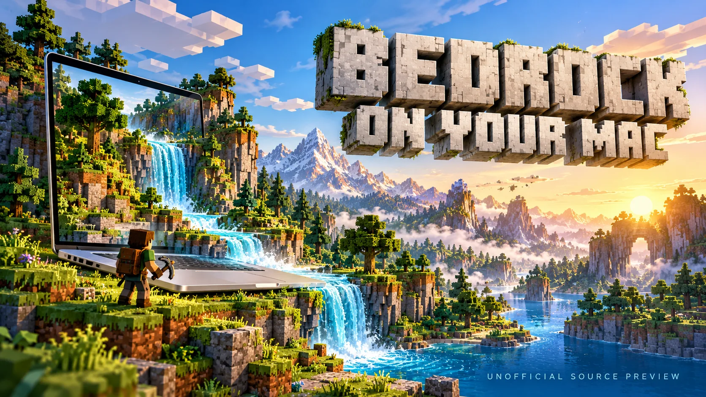
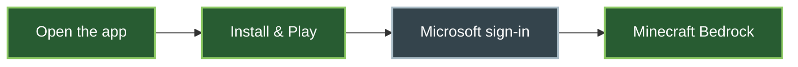

# Minecraft Bedrock for Mac



**Your Windows Bedrock game, on Apple Silicon** — a native macOS launcher with
Metal graphics through WineGDK and DXMT

[](https://github.com/keys-i/minecraft-mac/actions/workflows/checks.yml)
[](https://github.com/keys-i/minecraft-mac/actions/workflows/release.yml)
[](https://github.com/keys-i/minecraft-mac/actions/workflows/security.yml)

**[Build the Mac app →](docs/DEVELOPMENT.md)** · **[Install & play](docs/USER_GUIDE.md)** · **[Release status](docs/RELEASE.md)**

> **Source preview** · Runtime-included local DMG built and tested · Public notarised installer pending

## Windows Bedrock → macOS

<p align="center">
  
</p>

| Mac | Your account | Setup |
| --- | --- | --- |
| Apple Silicon · macOS 27+ · Rosetta | Owned Minecraft for Windows | Microsoft sign-in · Internet · 8 GB free |



The app obtains your licensed game separately · Worlds stay outside the app ·
Credentials stay in macOS Keychain · Next time, press **Play**

## One command, a cleaner build

```sh
python3 minecraft.py --help
```

| `src/` | `tools/` | `vendor/` |
| --- | --- | --- |
| Launcher & runtime | Build, source & diagnostics | Upstream patches & licences |

[Architecture](docs/CONTEXT.md) · [Checks & CI](docs/TESTING.md) ·
[Contribute](.github/CONTRIBUTING.md) · [Security policy](.github/SECURITY.md)

<details>
<summary>Build, package and inspect from the same CLI</summary>

```sh
python3 minecraft.py source fetch
python3 minecraft.py build launcher
python3 minecraft.py build app
python3 minecraft.py build dmg --output 'build/Minecraft-Mac-preview.dmg'
python3 minecraft.py source check
python3 minecraft.py monitor status
```

App/DMG packaging uses prepared runtime components and the packaging environment.
Follow the [complete build guide](docs/DEVELOPMENT.md) on a fresh checkout.
Use `COMMAND --help` for subcommands and arguments

</details>

<details>
<summary>Minecraft Bedrock on Mac — compatibility, cross-play and download FAQ</summary>

### Can you play Minecraft Bedrock on a Mac?

This unofficial project runs **Minecraft for Windows (Bedrock Edition)** on
Apple Silicon Macs using WineGDK, Rosetta and DXMT's Direct3D 11-to-Metal
translation. The current complete bundle requires macOS 27+; the recorded test
machine is an M3 Pro

### Is Minecraft Bedrock native on macOS?

The launcher is native macOS. The game remains the Windows edition running
through compatibility and translation layers. No Windows installation or
CrossOver subscription is needed

### Does Xbox, PlayStation, server and Realms cross-play work?

Earlier builds reached a featured server, the joined-Realm list and a PS5
friend world. See the [dated multiplayer evidence](docs/STABILITY.md) for the
specific builds and scenarios checked. Active Realm entry and complete
multiplayer validation on the combined launcher build remain open

### Do I need to own Minecraft for Windows?

Yes. Microsoft sign-in verifies real Windows Bedrock ownership. A console or
mobile licence alone does not establish PC ownership. No game, account or
saved world is included in this repository

### Where is the Mac DMG download?

A runtime-included local preview exists. Public binary distribution awaits
[signing, notarisation, clean-Mac testing and the remaining release gates](docs/RELEASE.md).
GitHub source archives contain buildable source; they are not an installed app

### Is it faster than Windows or native Minecraft?

No controlled gameplay comparison establishes that claim. Recorded changes
include a **155.7 → 127.2 MB DMG** and **259 → 164 ms median helper handoff**.
See the [measurement methods and limits](docs/PERFORMANCE.md)

</details>

<sub>Original AI-generated poster · [Artwork & screenshot sources](assets/README.md)</sub>

Derived from [1JRobertson/bedrock-mac](https://github.com/1JRobertson/bedrock-mac)
with upstream history retained · [GPLv3](LICENSE) · [Third-party notices](vendor/README.md)

<sub>Unofficial project, not affiliated with Mojang or Microsoft</sub>
