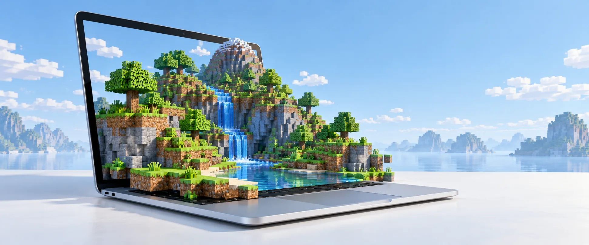
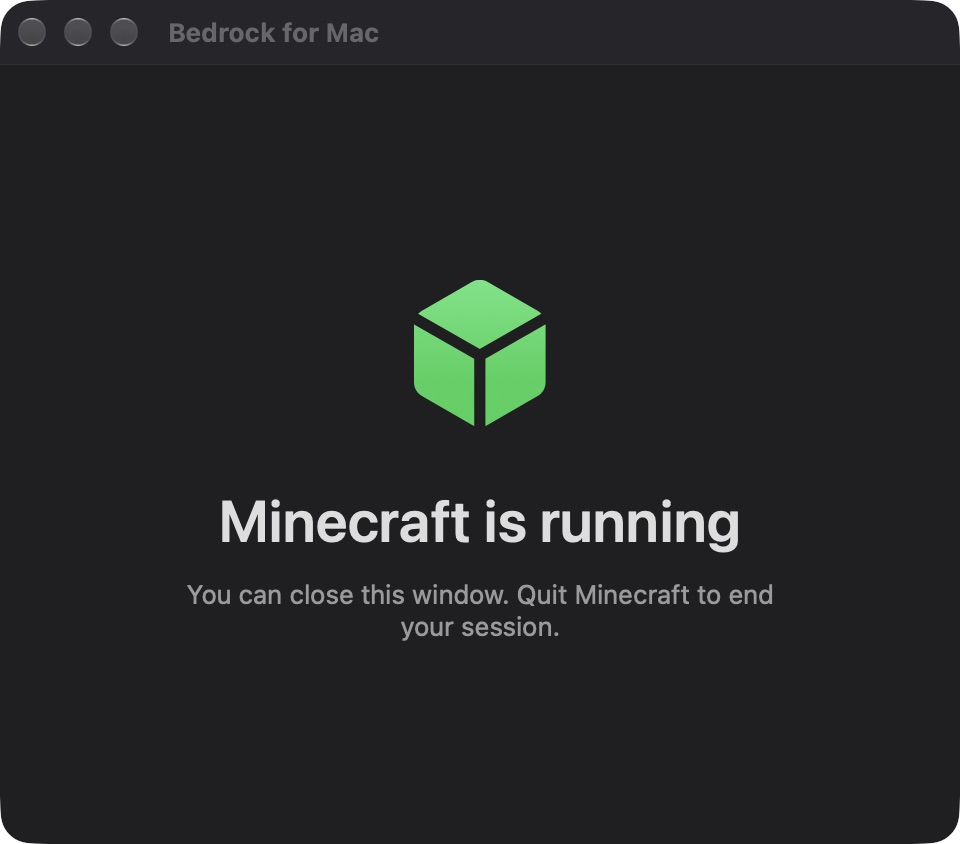
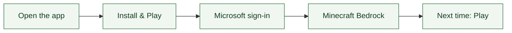

# Minecraft Bedrock for Mac

**minecraft-mac** runs your owned **Minecraft for Windows (Bedrock Edition)** on
**Apple Silicon macOS**, with a native Mac launcher and Metal graphics through
WineGDK and DXMT



<sub>Original AI-generated project artwork · [Asset sources](assets/README.md)</sub>

[](https://github.com/keys-i/minecraft-mac/actions/workflows/checks.yml)

**[Build for Mac](docs/DEVELOPMENT.md)** · **[Install & play](docs/USER_GUIDE.md)** · **[Release status](docs/RELEASE.md)**

> **Source preview** · The app runs locally; a public, notarised DMG is not available yet

## Windows Bedrock, a Mac launcher

<p align="center">
  
</p>

| Mac | Account | Setup |
| --- | --- | --- |
| Apple Silicon · macOS 27+ · Rosetta | Own Minecraft for Windows · Microsoft sign-in | Internet · 8 GB free |

The launcher is native macOS. The Windows game runs through WineGDK, Rosetta
and Direct3D 11-to-Metal translation; no Windows installation or CrossOver
subscription is needed

## From install to play



The app obtains your licensed game separately. Worlds stay outside the app
bundle, and credentials stay in macOS Keychain

## Smaller package, measured changes

| Runtime-included DMG | Helper handoff fixture |
| --- | --- |
| **155.7 → 127.2 MB** | **259 → 164 ms** median |

[Methods and results](docs/PERFORMANCE.md) · These measurements do not establish
gameplay FPS or a faster-than-Windows result

## Find your way around

```text
src/        Native Mac app, worker and runtime source
tools/      Build, packaging, diagnostics and source tooling
vendor/     Preserved upstream patches and licences
tests/      Offline checks and focused fixtures
docs/       Setup, architecture and release evidence
assets/     README artwork and real launcher capture
minecraft.py  One CLI with subcommands and arguments
```

[Architecture](docs/CONTEXT.md) · [Build guide](docs/DEVELOPMENT.md) ·
[Tests & CI](docs/TESTING.md) · [Contribute](.github/CONTRIBUTING.md) ·
[Source releases](docs/PUBLISHING.md)

<details>
<summary>One command for building and packaging</summary>

```sh
python3 minecraft.py build launcher
python3 minecraft.py build app --output 'build/packaged/Bedrock for Mac.app'
python3 minecraft.py build dmg --output 'build/Minecraft-Mac-preview.dmg'
```

The app command uses prebuilt runtime components; follow the
[full build guide](docs/DEVELOPMENT.md) on a fresh checkout

</details>

## Minecraft Bedrock on macOS: quick answers

<details>
<summary>Compatibility, cross-play, ownership and downloads</summary>

### Can you play Minecraft Bedrock on a Mac?

This project runs the Windows Bedrock edition on an Apple Silicon Mac using
WineGDK and DXMT. The current assembled bundle requires macOS 27+ and Rosetta;
the recorded test machine is an M3 Pro

### Is this an official native Minecraft Bedrock port for macOS?

It is an unofficial compatibility project with a native Mac launcher. The game
remains the Windows edition, running through Wine and Rosetta

### What about Xbox, PlayStation, servers and Realms cross-play?

Bedrock's Xbox networking is preserved. Earlier builds reached a featured
server, the joined-Realm list and a PS5 friend world. See the
[dated multiplayer results and remaining gaps](docs/STABILITY.md); each
scenario needs validation on its specific build

### Do I need a Minecraft for Windows licence?

Yes. Microsoft sign-in checks real ownership. No game files, Microsoft account
or saved world is included in this repository

### Where can I download the Mac DMG?

A runtime-included local preview has been built and tested. A public binary
release awaits the [release checks](docs/RELEASE.md). GitHub source archives
contain buildable source, not an installed Mac app

</details>

Derived from [1JRobertson/bedrock-mac](https://github.com/1JRobertson/bedrock-mac)
with upstream history retained · [GPLv3](LICENSE) ·
[Third-party notices](vendor/README.md) · [Security](.github/SECURITY.md)

<sub>Unofficial project, not affiliated with Mojang or Microsoft</sub>
